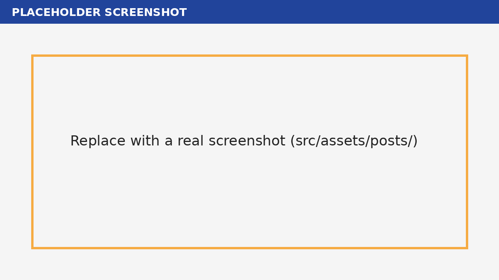

> **Sample tutorial (placeholder).** All commands and code are copied from the [Insyra README](https://github.com/HazelnutParadise/insyra) (dev branch, read on 2026-11-04).

## Goal

Set up a Go project with Insyra and use a `DataList` to store some numbers and calculate their mean.

## Prerequisites

- Go installed ([download](https://golang.org/dl/))
- An editor. The README suggests VSCode, or [Idensyra](https://github.com/HazelnutParadise/idensyra) if you want something lighter.

## Step 1: Create a Go module

```sh
go mod init your_project_name
```

## Step 2: Install Insyra

```sh
go get github.com/HazelnutParadise/insyra/allpkgs
```

## Step 3: Create a DataList

Create `main.go`:

```go
package main

import (
    "fmt"
    "github.com/HazelnutParadise/insyra"
)

func main() {
    dl := insyra.NewDataList(1, 2, 3, 4, 5)
    dl.Append(6)
    fmt.Println("DataList:", dl.Data())
    fmt.Println("Mean:", dl.Mean())
}
```

Then run it:

```sh
go run main.go
```

## Expected result

The program prints the six values in the list (1 to 6) and their mean. Six values from 1 to 6 have an arithmetic mean of 3.5. The exact print format is not shown here; check your own terminal.



## Optional: the shorter syntax

The README recommends the `isr` syntactic sugar package, where `isr.DL.Of(1, 2, 3, 4, 5)` replaces `insyra.NewDataList(1, 2, 3, 4, 5)`.

## Next steps

- [How to build a DataTable from DataLists](/posts/how-to-build-a-datatable-in-go-with-insyra/)
- [DataList documentation](https://github.com/HazelnutParadise/insyra/blob/main/Docs/DataList.md)
- [Insyra docs](https://hazelnutparadise.github.io/insyra/)
