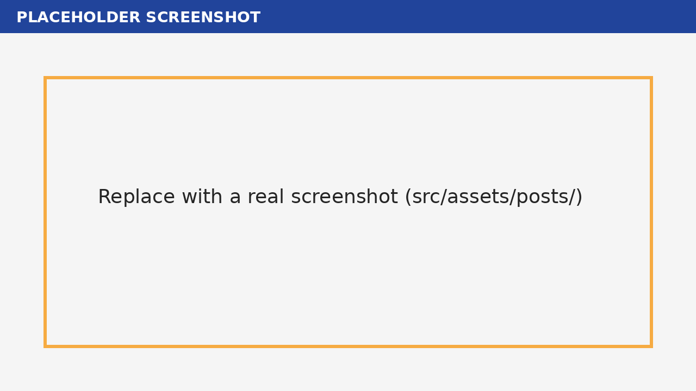

> **Placeholder.** This sample post exists to show the layout. Every command and snippet below is copied from the [Insyra README](https://github.com/HazelnutParadise/insyra) (dev branch, read on 2026-11-04).

## Install

Create a Go module, then install Insyra:

```sh
go mod init your_project_name
go get github.com/HazelnutParadise/insyra/allpkgs
```

## A first DataList

This is the README's quick example:

```go
package main

import (
    "fmt"
    "github.com/HazelnutParadise/insyra"
)

func main() {
    dl := insyra.NewDataList(1, 2, 3, 4, 5)
    dl.Append(6)
    fmt.Println("DataList:", dl.Data())
    fmt.Println("Mean:", dl.Mean())
}
```

### With syntactic sugar

The README recommends the `isr` package, which lets you write `isr.DL.Of(1, 2, 3, 4, 5)` instead of `insyra.NewDataList(...)`.

## Screenshots go here



## Next

See the [DataList documentation](https://github.com/HazelnutParadise/insyra/blob/main/Docs/DataList.md).
